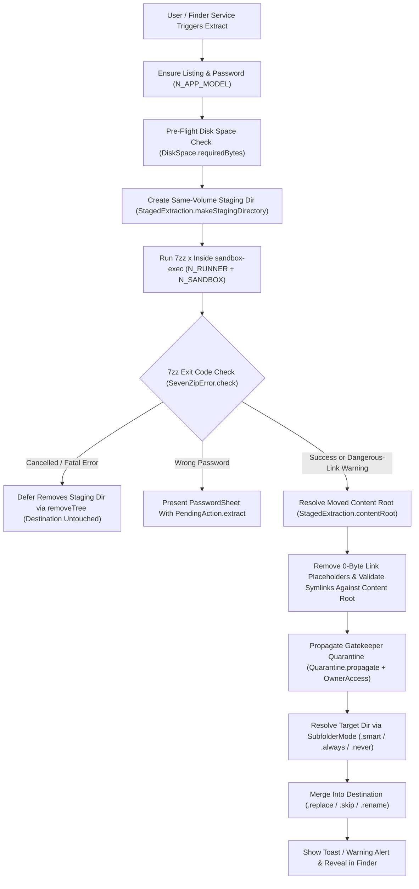
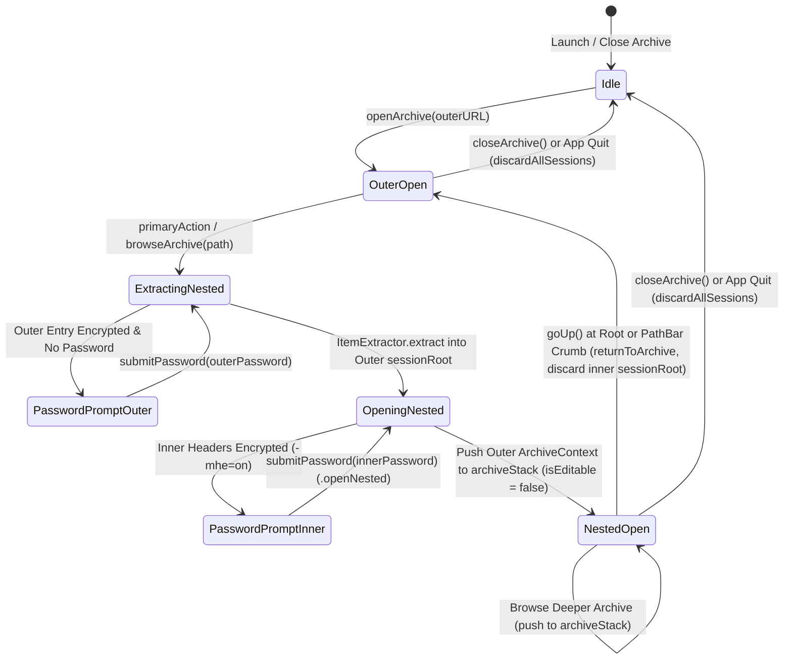

# Symbolic Memory Graph — State Topology & Node Lookup

> **Memory Category:** TencentDB Symbolic Short-Term Memory Topo-Graph  
> **Scope:** State machines, execution pipelines, and symbolic `node_id` lookup for `Arhivar`.

---

## 1. Symbolic Node Lookup Table (`node_id`)

| `node_id` | Symbol / Component | File | Role |
| :--- | :--- | :--- | :--- |
| `N_APP_MODEL` | `AppModel` | `Sources/Arhivar/AppModel.swift` | Central `@Observable` coordinator for UI state and `7zz` tasks |
| `N_SETTINGS` | `AppSettings` | `Sources/Arhivar/AppSettings.swift` | `UserDefaults` persistence and trilingual `StringTable` formatter |
| `N_RUNNER` | `CommandRunner` | `Sources/ArhivarCore/CommandRunner.swift` | Async process runner with `stdin` pipe, progress, timeout, and `SIGKILL` |
| `N_SANDBOX` | `SandboxProfile` | `Sources/ArhivarCore/Sandbox.swift` | Per-operation `sandbox-exec` SBPL policy generator |
| `N_CMD` | `SevenZipCommand` | `Sources/ArhivarCore/ArchiveOptions.swift` | Pure CLI argument builder (`l`, `t`, `x`, `a`, `d`, `rn`, `h`) |
| `N_PARSER` | `ListingParser` | `Sources/ArhivarCore/ArchiveListing.swift` | Byte-level `7zz l -slt` parser and path normalizer |
| `N_TREE` | `ArchiveTree` | `Sources/ArhivarCore/ArchiveTree.swift` | Hierarchical folder synthesizer, `.localizedStandard` sorter, search |
| `N_STAGED` | `StagedExtraction` | `Sources/ArhivarCore/StagedExtraction.swift` | Atomic staging directory, `secureSymlinks`, `removeLinkPlaceholders`, `installArchive`, `removeTree`, `OwnerAccess`, smart subfolder, merge |
| `N_QUARANTINE` | `Quarantine` | `Sources/ArhivarCore/Quarantine.swift` | `com.apple.quarantine` sanitizer and recursive propagator |
| `N_SAFETY` | `OpenSafety` | `Sources/ArhivarCore/OpenSafety.swift` | Risky UTI / execute-bit detector and Unicode spoof sanitizer |
| `N_STACK` | `AppModel.archiveStack` | `Sources/Arhivar/AppModel.swift` | LIFO stack of `ArchiveContext` frames for nested archive browsing |
| `N_UPDATE_SIG` | `UpdateSignature` / `UpdateChecksums` | `Sources/ArhivarCore/AppUpdate.swift` | Ed25519 release signature and SHA-256 release checksum verifier |

---

## 2. Archive Extraction & Security Pipeline (`N_STAGED`)

---

## 3. Nested Archive Stack Lifecycle (`N_STACK`)

