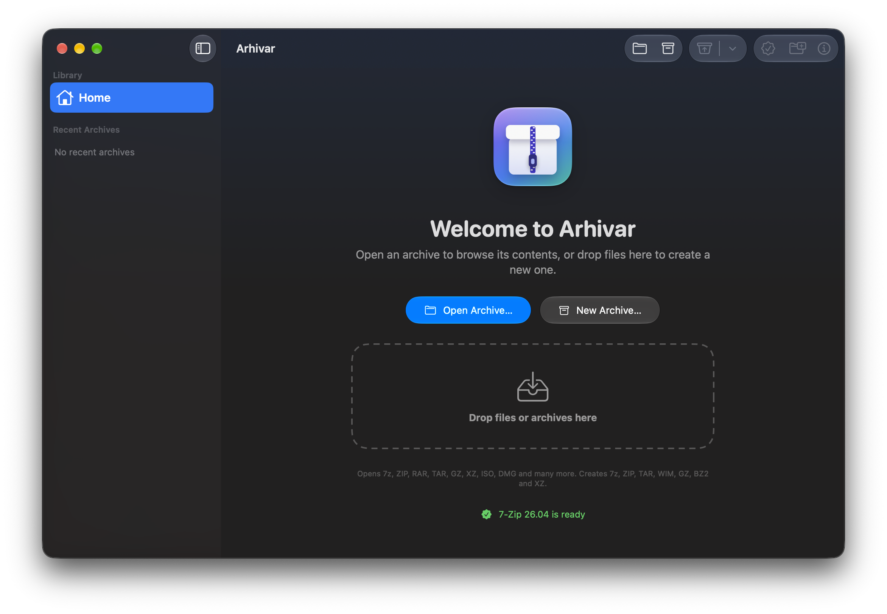

# Arhivar

A native archive manager for macOS 26+, built with SwiftUI and Liquid Glass on top of 7-Zip (`7zz`). It is built as a universal app (Apple Silicon + Intel), and the 7-Zip engine ships inside the app bundle.

<p align="center">
  
</p>

## Features

- **Archive browser**
  - Folder view: double-click to enter a folder, ⌘↑ to go up, clickable path bar
  - Tree view; switch between views with ⌘1 and ⌘2
  - Sorting, search, Finder icons, status bar, archive info
- **Quick Look:** press Space
- **Drag to Finder:** a file or folder is extracted the moment it is dropped
- **Open:** 7z, ZIP, RAR, TAR, GZ, XZ, ISO, DMG and every other format 7-Zip can read
- **Create:** 7z, ZIP, TAR, WIM, GZIP, BZIP2, XZ; compression level, AES-256, file name encryption, split volumes
- **Edit (7z, ZIP, TAR, WIM):** add files (including drag and drop), delete, rename
- **Finder context menu:** Extract Here / Open / Compress with Arhivar
- **Document icons:** when Arhivar is the default app for a type, archives get Arhivar icons (ZIP, 7Z, RAR, TAR family, disk images, other archives)
- **Languages:** Turkish (default), English, Romanian
- **Appearance:** Automatic, Light, Dark
- **Windows:** Settings and About
- **7-Zip updater:** downloads from [github.com/ip7z/7zip](https://github.com/ip7z/7zip/releases), verifies with SHA-256, and updates the 7-Zip copy in the project and inside the app.

## Installation

**Requires:** macOS 26 (Tahoe) or later. Runs on Apple Silicon and Intel Macs.

1. Download the latest `Arhivar-<version>.dmg` from the [Releases](https://github.com/berkbb/arhivar-mac-universal/releases) page.
2. Optionally verify the download. Run this in the folder you downloaded it to:
   ```bash
   shasum -a 256 -c Arhivar-<version>.sha256 --ignore-missing
   ```
3. Open the `.dmg` and drag **Arhivar** into the **Applications** folder.
4. **First launch:** Arhivar is ad-hoc signed rather than signed with an Apple Developer ID, so macOS shows an "Arhivar can't be opened" warning the first time.
   - Close the warning with **Done**.
   - Go to **System Settings › Privacy & Security**, click **Open Anyway** next to "Arhivar was blocked", and confirm with your password.
   - You only need to do this once, although macOS may ask again after an update.
5. On first launch, Arhivar asks for permission to check GitHub for updates automatically. You can change this later in **Settings › Advanced**.

**Finder context menu:** the "Extract Here / Open / Compress with Arhivar" items appear under right-click › **Quick Actions** or **Services**. If they are missing, enable them in System Settings › Keyboard › Keyboard Shortcuts › Services › Files and Folders.

**Updates:** **Check for Arhivar Updates…** in the Arhivar menu opens the download link when a new version is available. The 7-Zip engine is updated from inside the app with **Check for 7-Zip Updates…**.

## Development

Double-click in Finder:

- **`Paketle.command`** (package): runs the tests and produces a universal `build/Arhivar.app` plus a `.dmg`, a `.zip` and a SHA-256 file under `dist/`.
- **`7-Zip-Guncelle.command`** (update 7-Zip): updates `Vendor/7-Zip` and, if present, the 7-Zip copy inside `build/Arhivar.app` to the latest version.
- **`Yayimla.command`** (publish): first shows what it will do in dry-run mode. If you confirm, it packages the release and uploads it to GitHub Releases with a `v<version>` tag. GitHub Actions is not used; everything runs on this Mac.

The same tasks from the terminal:

```bash
./Scripts/package.sh                  # tests + universal .app + .dmg + .zip
./Scripts/package.sh --update-7zip    # update 7-Zip first, then package
./Scripts/build_app.sh                # build/Arhivar.app only
./Scripts/update-7zip.sh check        # is a newer 7-Zip available?
./Scripts/update-7zip.sh install      # update Vendor/7-Zip
./Scripts/update-7zip.sh install --app build/Arhivar.app
./Scripts/set-version.sh 1.0.1        # change the version (single source: Support/Info.plist)
./Scripts/release.sh --dry-run        # rehearse a release without sending anything
./Scripts/release.sh                  # package, tag and upload to GitHub Releases
swift test                            # 230 tests
```

Requires Xcode 26 or later. See [DEVELOPMENT.md](DEVELOPMENT.md) for details, [roadmap.md](.agents/context/roadmap.md) for planned features and [CHANGELOG.md](CHANGELOG.md) for release notes.

## License

Arhivar's own code is MIT licensed ([LICENSE](LICENSE)). The bundled 7-Zip is distributed under the GNU LGPL with the unRAR restriction ([THIRD_PARTY_NOTICES.md](THIRD_PARTY_NOTICES.md)). Because of that restriction, Arhivar can extract RAR archives but cannot create them.
